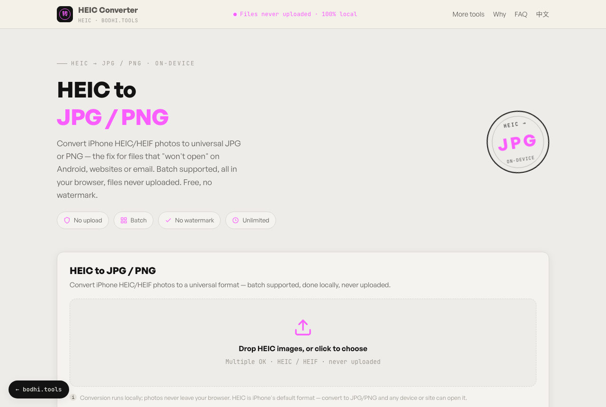

# HEIC Converter

**English** · [简体中文](README.zh-CN.md)

Convert iPhone HEIC/HEIF photos to JPG or PNG in your browser, in batches, without uploading them. Use it when a HEIC file won't open on Android, Windows, a website or an online form.

**Try it:** https://heic.bodhi.tools/en/



## Features

- Accepts `.heic` and `.heif` files, several at once
- Outputs JPG (quality 0.92) for sharing or PNG for lossless output
- Download each file, or all of them as one ZIP
- The decoder loads only when you click Convert, so the page opens fast
- No watermark, no signup, no usage limits
- English and Simplified Chinese interface

## How it works

[heic-to](https://github.com/hoppergee/heic-to) wraps [libheif](https://github.com/strukturag/libheif) compiled to WebAssembly. The browser decodes each HEIC image and re-encodes it as JPG or PNG; [JSZip](https://stuk.github.io/jszip/) packs multiple results into a ZIP.

## Privacy

- Your photos are read and converted in your browser. The app has no upload endpoint.
- The decoder is bundled with the app; the page loads only fonts from Google Fonts and Fontshare.
- The hosted site at heic.bodhi.tools uses Cloudflare Web Analytics, which counts page views without cookies. If you self-host and don't want it, delete the `cloudflareinsights` script tag in `index.html` and `en/index.html`.

## Run it locally

Requires Node.js 20.19+ (or 22.12+) and [pnpm](https://pnpm.io).

```bash
git clone https://github.com/bodhi1425/heic-converter.git
cd heic-converter
pnpm install
pnpm dev     # http://localhost:5173
pnpm build   # static site in dist/
```

`dist/` contains only static files. Host it on Cloudflare Pages, Netlify, GitHub Pages or any web server.

## Project layout

```
index.html       Chinese page (/)
en/index.html    English page (/en/)
src/main.ts      UI and conversion logic
src/style.css    Styles
public/          favicon, robots.txt, sitemap.xml
```

## Built with

| Package | Used for | License |
|---|---|---|
| [heic-to](https://github.com/hoppergee/heic-to) (libheif) | HEIC decoding | LGPL-3.0 |
| [JSZip](https://stuk.github.io/jszip/) | ZIP download | MIT (dual MIT / GPL-3.0) |
| [Vite](https://vite.dev), [TypeScript](https://www.typescriptlang.org) | Build | MIT, Apache-2.0 |

heic-to is used as an unmodified npm dependency under the LGPL-3.0. You can replace it with another build by changing `package.json` and rebuilding.

## More privacy-first tools

Each one runs entirely in your browser:

- [local-pdf-toolbox](https://github.com/bodhi1425/local-pdf-toolbox): merge, split, compress and convert PDFs
- [image-compressor](https://github.com/bodhi1425/image-compressor): compress an image to an exact KB size
- [qrcode](https://github.com/bodhi1425/qrcode): QR codes with logos, gradients, Wi-Fi and vCard
- [ocr](https://github.com/bodhi1425/ocr): extract text from images
- [cutout](https://github.com/bodhi1425/cutout): remove image backgrounds with an on-device AI model

## Contributing

Bug reports and pull requests are welcome. Please open an issue first for larger changes.

## License

[MIT](LICENSE) © 2026 bodhi1425
